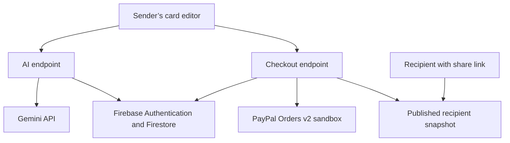

# Hackathon architecture

This diagram describes the implementation intended for the hackathon release. The deployed provider flow remains pending verification.

The AI endpoint receives only the consented brief. The checkout endpoint uses the authenticated sender and card ID to load the server-owned order. A verified final capture is required before publishing the unlisted premium snapshot.
